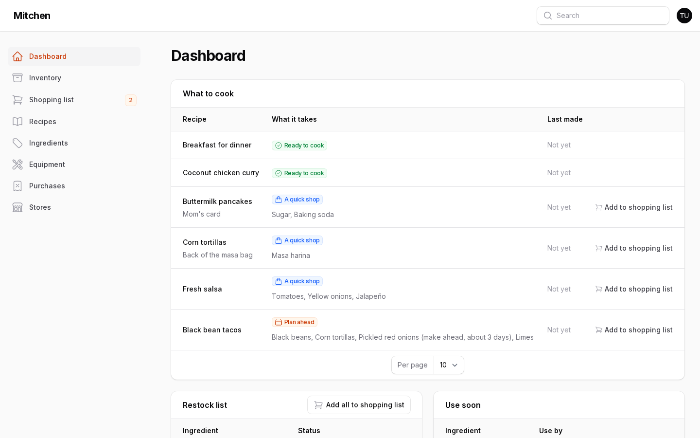
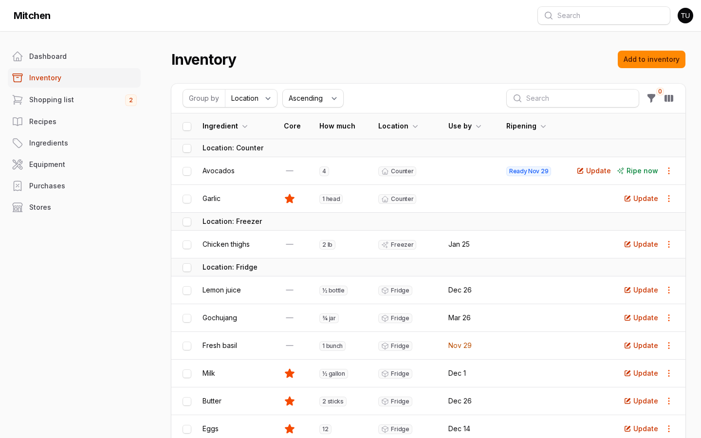
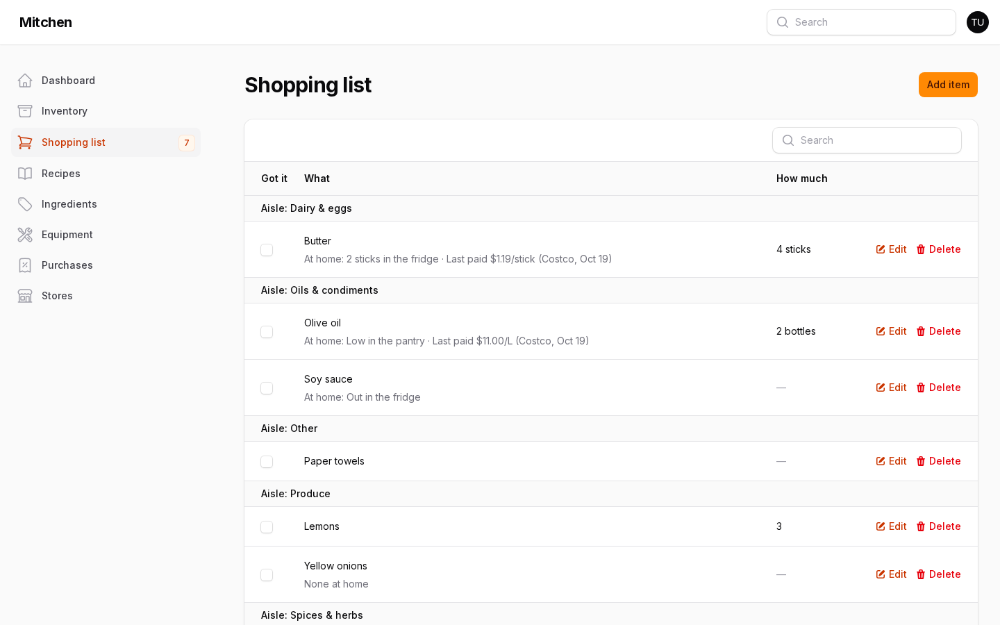
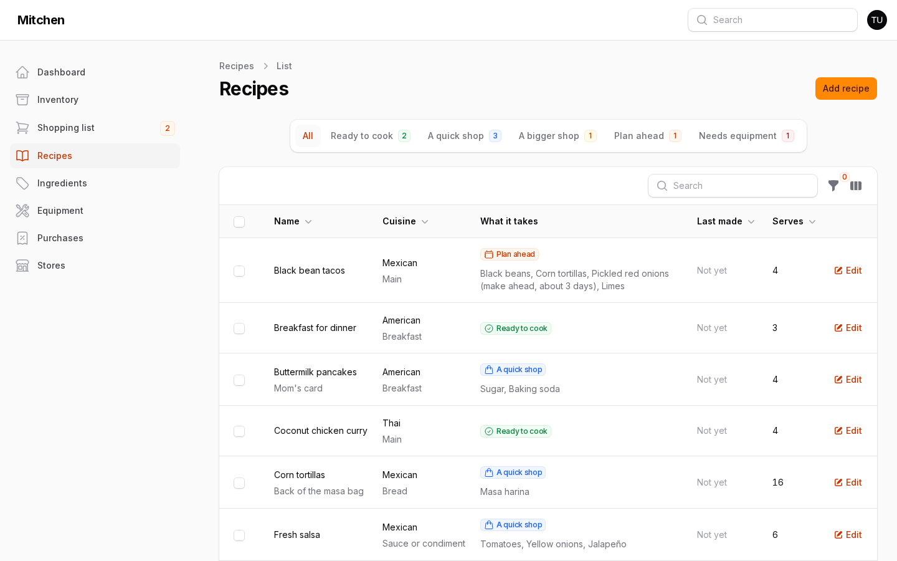
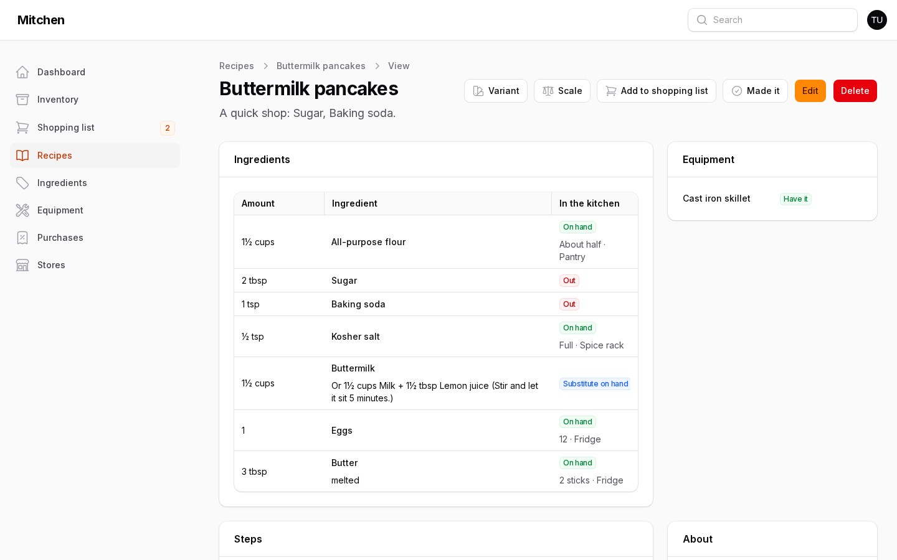

# Mitchen

[](https://github.com/philmareu/mitchen/actions/workflows/tests.yml)

**A self-hosted kitchen assistant that knows what's in your kitchen.**

Mitchen keeps track of your ingredients and how much of each you have, without making you weigh anything. Type `half a jar`, `2 lb`, `a couple cans` or just `low`, and it understands. It knows which ingredients are staples you always keep on hand, so it can tell you what to restock, keep a shopping list, and remind you what to use before it goes off.

Your recipes live alongside it, so each one shows what's on hand, what's missing and what to buy. Mitchen has no AI of its own: connect Claude to it and you have an assistant that cooks with the ingredients and equipment you actually have. Meal planning is next.

You run Mitchen yourself, and your kitchen is stored only on your server. It makes no AI calls and needs no API key. Built with [Laravel](https://laravel.com) and [Filament](https://filamentphp.com).



| Inventory | Shopping list |
|---|---|
|  |  |

| Recipes | A recipe |
|---|---|
|  |  |

## Project status and support

Mitchen is a personal project. I built it for my own kitchen, I use it every day, and I maintain it alone in my spare time. What that means for you:

- **No warranty and no paid support.** Mitchen is licensed under the [AGPL-3.0](LICENSE) and comes as it is. You host it, you look after it, and you run it at your own risk.
- **Bug reports are welcome** in [issues](https://github.com/philmareu/mitchen/issues). A reply may take a while.
- **Feature requests may be closed** when they don't fit what I need from Mitchen. Forking is encouraged if you want to take it somewhere else.
- **Pull requests.** Small, focused bug fixes with tests are the most likely to be merged. Open an issue before you start anything larger, and read the terms for contributions in [CONTRIBUTING.md](CONTRIBUTING.md).
- **Security reports come first.** Send them through GitHub's private vulnerability reporting, not a public issue. See [SECURITY.md](SECURITY.md).

## Features

- **Write quantities the way you'd say them.** One box takes exact amounts (`500g`, `1 1/2 cups`, `1½ cups`), containers (`half a jar`, `3 cans`, `two thirds of a bag`) or a rough level (`plenty`, `about half`, `running low`, `out`). The form shows what it understood as you type, and stores the result as structured data.
- **Core vs. one-off ingredients.** Mark the staples you always keep on hand. When a core ingredient is used up it stays in your inventory as *out* and goes on the restock list. A one-off bought for a single recipe just disappears.
- **Restock list, with restock points.** Core ingredients that are low, out, or not stocked at all, with a one-click "Restocked" that records what you bought. Give an ingredient its own restock point (`¼ jar`, `2 cans`, `1 lb`, or `out`) and it goes on the list when what you have adds up to that, converting between units (`12 oz` counts against `1 lb`). Say how much you like to stock up to (`10 lb`, `4 cans`) and the list works out how much to buy: 10 lb less the 2 lb in the pantry is 8 lb, filled in when it goes on the shopping list.
- **Shopping list.** Grouped by aisle, with what you already have at home under each item. Bring in everything on the restock list in one click, add your own items, tick things off in the store, then put away what you got: check how much and where, and it's added to the inventory and comes off the list.
- **Order online.** Give a store the address of its online shop (search it for milk and paste the address) and everything on the shopping list gets a link that looks it up there. Find it, add it to the store's cart, tick it off, and put it away when the order arrives. It works with any shop that has a search box, the local grocer's included.
- **Purchase history and prices.** Every shop is recorded with its store, date, total and what each thing cost: put away what you ticked off, have Claude read the receipt, or add one by hand. See what you spent this month, which store you shop at most, and what you last paid per unit (`$3.49/lb`, `$0.33 each`) right on the shopping list.
- **Use soon.** Anything with a use-by date in the next week.
- **Organized by place.** Pantry, fridge, freezer, spice rack and counter, with filters for core items and anything running low.
- **Equipment.** Everything you cook with, from the stand mixer down to a ladle, with its brand, size and photos of your own pieces. A recipe that calls for a piece counts it as there once it's listed.
- **Recipes.** Type one in with its ingredients, equipment and steps, and keep a photo of the original card with it. Each ingredient links to the one you keep by name, and anything new is added to your ingredients.
- **What's in the kitchen for each recipe.** Every ingredient shows *on hand*, *running low* or *out*, and where it is (`2 lb · Fridge`); every piece of equipment, whether you have it. Put what's missing on the shopping list in one click, with the amounts the recipe calls for. Water and ice count as always on hand.
- **What to cook.** Recipes sorted by how close you are to making them: *ready to cook*, *a quick shop* (up to three things), *a bigger shop*, *plan ahead* or *needs equipment*, with what's missing. Mark an ingredient as hard to find, seasonal (with its months) or homemade with how long a batch takes, and recipes that need it are planned for rather than ruled out: "Plan ahead: Pickled red onions (make ahead, about 3 days)". If a variant gets you closer (no cilantro), it says so. Avocados bought hard can be marked as ripening until a date, so guacamole waits for them instead of sending you to the store. Filter by cuisine, course, main protein, diet or your own tags: something Italian, a side, a vegetarian main. The dashboard suggests what's ready or close, made longest ago first, and puts what to buy on the shopping list in one click.
- **Scale a recipe.** Halve or double it, and the amounts Mitchen can read are scaled (`1½ cups` becomes `¾ cup`); `a pinch` stays a pinch.
- **Recipes that get better.** Press *Made it* to log a batch: how it turned out and what to change next time, even days later (pickles taste right on day three). The notes wait on the recipe until you work them in, by hand or by asking Claude ("more salt, less vinegar" becomes `1½ tsp` salt and `¾ cup` vinegar, shown to you before it's saved). Every change keeps the old version, with what changed.
- **Substitutes and variants.** A substitute stands in for one ingredient when you're out (no buttermilk: milk and lemon juice), so the recipe still counts as ready to cook. A variant is a way of making it you pick up front (mild or hot salsa, blueberry pancakes), and the ingredients and shopping list follow it.
- **Claude is the assistant.** Mitchen is an MCP server, so you can connect it to the Claude app and talk to your kitchen from the counter: what can I make tonight, what's on the shopping list, what should I use up? Tell it what you bought or finished, or send it a photo of the receipt or the fridge, and it reads the changes back, saving them once you agree. Hand it a recipe from a website or a photo of a card and it saves it to your collection; tell it how dinner turned out and it goes in the cook log, then have it work those notes into the next version of the recipe.

## Before you start

- **PHP 8.4 or 8.5** (8.4.1 or newer; the locked dependencies don't install on 8.3), with the [extensions Laravel requires](https://laravel.com/docs/13.x/deployment#server-requirements) plus `intl`, `sodium`, `zip` and `pdo_sqlite` (or `pdo_mysql`). Composer stops and names anything that's missing.
- **Composer 2** and **Git**.
- **A database.** SQLite is the default and needs no setup. MySQL works too.
- **Claude, or another MCP client,** if you want the assistant. The app works without one.

Node is not required.

## Try it with sample data

The fastest way to look around.

```bash
git clone https://github.com/philmareu/mitchen.git
cd mitchen
composer setup
php artisan migrate --seed
php artisan serve
```

Open the URL the last command prints and sign in as `test@example.com` with the password `password`.

You get a lived-in kitchen: ingredients at every stock level, staples that need restocking, a shopping list, a few past shops with prices, equipment, and eight recipes at every stage from ready to cook to needing a piece of equipment, with substitutes, variants and a cook log.

The demo is for looking around on your own machine. Its login has a password anyone can look up, so it only loads where nobody's real kitchen lives: seeding refuses to run when `APP_ENV=production`, in a database that already has another login, and into a kitchen that already has something in it. `php artisan migrate:fresh --seed` starts the demo over.

When you want your own login in this copy, wipe the demo first. `mitchen:install` won't add a real login next to the demo one:

```bash
php artisan migrate:fresh   # deletes everything in the database
php artisan mitchen:install
```

## Install

This gets Mitchen running on your own computer with your own login and an empty kitchen. For a copy you leave running, follow [Run it on a server](#run-it-on-a-server) instead.

```bash
git clone https://github.com/philmareu/mitchen.git
cd mitchen
composer setup
php artisan mitchen:install
php artisan serve
```

- `composer setup` installs the dependencies, development tools included, and creates `.env`, an app key and an empty SQLite database at `database/database.sqlite`.
- `php artisan mitchen:install` runs the migrations, writes the keys Claude signs in with to `storage/`, then asks for the name, email and password (at least 8 characters) of your login.
- `php artisan serve` starts a development server. Open the URL it prints and sign in.

Then fill the kitchen. Add what you keep under **Ingredients** and mark the staples as core, or [connect Claude](#connecting-claude) and tell it what's in the pantry.

To add a login for someone else later, run `php artisan make:filament-user`. Everyone who signs in shares the one kitchen: there are no roles and no separate kitchens.

## Connecting Claude

Mitchen serves an MCP server at `/mcp`. Its tools read the kitchen (what's on hand, the restock and use-soon lists, the shopping list, recipes by how close you are to making them, equipment) and update it (bought, used up, how much is left, the shopping list, how much of a staple to keep, new recipes, the cook log, revisions from your notes, previewed before they're saved, and equipment you forgot to list, so recipes that need it count it as there), using the same actions as the app. Claude does the understanding on its side: Mitchen has no API key and makes no AI calls of its own.

The shopping list comes with a link into each store's online shop for everything on it, so a Claude that can use your browser can fill the cart there and read it back to you. Checking out stays with you.

Clients sign in with OAuth through [Laravel Passport](https://laravel.com/docs/passport). `php artisan mitchen:install` writes the keys it needs to `storage/oauth-private.key` and `storage/oauth-public.key`. To keep them in the environment instead, set `PASSPORT_PRIVATE_KEY` and `PASSPORT_PUBLIC_KEY`.

**The Claude apps** (claude.ai, desktop and mobile):

1. In Claude, open **Settings**, then **Connectors**, and add a custom connector with your address plus `/mcp`, such as `https://mitchen.example.com/mcp`.
2. Connect. Claude sends you to Mitchen, where you sign in and approve it.

Claude's apps connect from Anthropic's servers, not from your device. So for them Mitchen has to be reachable from the internet over HTTPS: see [Run it on a server](#run-it-on-a-server).

**Claude Code** connects from your own machine, so an address on your home network or VPN is enough:

```bash
claude mcp add --transport http mitchen https://mitchen.example.com/mcp
```

Then run `/mcp` in Claude Code to sign in.

**Other clients.** A client registers itself with Mitchen, but Mitchen only lets it send you back, after you approve it, to Claude's apps or to your own machine. That covers the Claude apps and Claude Code and nothing else. Another client that speaks MCP over HTTP with OAuth works once you add its address to `.env`, next to the two defaults:

```dotenv
MCP_REDIRECT_DOMAINS=https://claude.ai,http://localhost,https://assistant.example
```

An approved client can do everything the tools do: read the whole kitchen and change it. [Security](#security) says how long a connection lasts and how to cut one off.

## Run it on a server

`php artisan serve` is a development server. For a copy of Mitchen you leave running, use a real web server with HTTPS. Mitchen is a standard Laravel application, so anything that hosts Laravel hosts Mitchen.

You need PHP-FPM behind Nginx, Apache or Caddy, and an HTTPS certificate. Whether the server has to be reachable from the internet depends on how you'll talk to it: the Claude apps need that, while a browser and Claude Code are happy with a machine on your home network or VPN.

### 1. Pick the user

PHP-FPM runs as a user, often `www-data`. That user must be able to write to `storage/`, `bootstrap/cache/` and, with SQLite, to `database/` and the database file in it.

The setup with the fewest surprises is one user for everything: the same user owns Mitchen's files, runs PHP-FPM and runs the commands below. Then a file one of them creates can always be written by the others. If PHP-FPM runs as `www-data` and you work as someone else, run the commands as `www-data`, for example:

```bash
sudo -u www-data php artisan optimize
```

### 2. Install the code

Clone Mitchen where your web server will serve it from. The examples below use `/var/www/mitchen`:

```bash
cd /var/www
git clone https://github.com/philmareu/mitchen.git
cd mitchen
composer install --no-dev --optimize-autoloader
cp .env.example .env
php artisan key:generate
```

`--no-dev` leaves out the testing and development packages.

### 3. Edit `.env`

`.env.example` has Laravel's development values. Change these, and add `APP_TIMEZONE`:

```dotenv
APP_ENV=production
APP_DEBUG=false
APP_URL=https://mitchen.example.com
APP_TIMEZONE=America/Chicago
```

- `APP_ENV=production` and `APP_DEBUG=false` belong on any server other people can reach. Debug mode shows the details of every error to whoever caused it, and production is what keeps the demo and its public password from being loaded.
- `APP_URL` is the address you open Mitchen at. When it starts with `https://`, Mitchen's session cookie is only ever sent over HTTPS.
- `APP_TIMEZONE` decides what "today" is for use-by dates, what's ripening, what's in season and the cook log. Without it, today follows UTC.

SQLite needs no database settings. For MySQL, create an empty database and replace the `DB_CONNECTION=sqlite` line:

```dotenv
DB_CONNECTION=mysql
DB_HOST=127.0.0.1
DB_PORT=3306
DB_DATABASE=mitchen
DB_USERNAME=mitchen
DB_PASSWORD=your-password
```

Photos of recipe cards and equipment are kept privately in `storage/app/private`. To keep them on S3 instead, set `FILESYSTEM_DISK=s3` and the `AWS_*` values, and give the bucket a CORS rule allowing `GET` from your address, so the photo fields can load them. Uploads still go through Mitchen, never straight to the bucket.

`.env` now holds your app key. Make it readable by its owner only:

```bash
chmod 600 .env
```

### 4. Create the database and your login

```bash
touch database/database.sqlite   # SQLite only
php artisan mitchen:install
php artisan optimize
```

`php artisan mitchen:install` runs the migrations, writes the keys Claude signs in with to `storage/`, and asks for the name, email and password of your login. Run it again whenever you like: it keeps the keys it finds.

`php artisan optimize` caches the configuration, routes and views. From then on Mitchen reads the cache, not `.env`, so **run `php artisan optimize` again after every change to `.env`**.

If your deploys replace the whole directory (zero-downtime deploys do), keep `storage/` shared between releases, or the keys, the photos and a SQLite database won't carry over.

### 5. Point the web server at `public/`

The document root is the `public/` directory inside Mitchen, never the project root, which holds `.env`.

- **Nginx.** Use the [configuration in Laravel's deployment guide](https://laravel.com/docs/13.x/deployment#nginx). Change `server_name`, `root` and the PHP-FPM socket, then add your certificate.
- **Apache.** `public/.htaccess` is included. Enable `mod_rewrite` and allow overrides for the directory.
- **Caddy.** `root` at `public/` with `php_fastcgi` and `file_server`. Caddy gets the certificate for you.

Mitchen takes photos of up to 10 MB each. PHP's own limit is 2 MB until you raise it: set `upload_max_filesize` and `post_max_size` in `php.ini` to 12M or more, and with Nginx `client_max_body_size` to match.

If HTTPS ends at a separate reverse proxy, load balancer or tunnel that passes plain HTTP on to PHP, tell Mitchen which proxy to believe. Add `TRUSTED_PROXIES` to `.env` with its address: `127.0.0.1` for a proxy on the same machine, or several addresses or CIDR ranges separated by commas. Without it, Mitchen takes every request for plain HTTP from the proxy itself: pages link their CSS and JavaScript over `http://` and break, Claude is told to sign in at an `http://` address, and everyone's failed sign-ins count against one address. `TRUSTED_PROXIES=*` believes whatever connects, which is only safe when nothing but the proxy can reach PHP.

### 6. Nothing to schedule

Mitchen needs no cron entry and no queue worker. It runs nothing on a schedule and nothing in the background.

### 7. Check it

Open your address and sign in. Then open `/.well-known/oauth-protected-resource/mcp`: the addresses in it should start with `https://` and be the ones you'd type. If they don't, `APP_URL` or `TRUSTED_PROXIES` needs another look before Claude can connect.

`/up` returns 200 while Mitchen is running, for an uptime monitor. When something goes wrong, look at `storage/logs/laravel.log`.

## Update

There are no numbered releases yet. Updates land on the `main` branch, and the [commit history](https://github.com/philmareu/mitchen/commits/main) shows what changed. [SECURITY.md](SECURITY.md) says how to be told about security fixes.

Back up first ([Back up and restore](#back-up-and-restore)), then:

```bash
cd /var/www/mitchen
php artisan down
git pull
composer install --no-dev --optimize-autoloader
php artisan migrate --force
php artisan optimize
php artisan up
```

`php artisan down` shows a maintenance page while you work. `composer install` clears the caches, so always finish with `php artisan optimize`.

On a copy you installed with `composer setup`, `git pull`, `composer install` and `php artisan migrate` are enough.

## Back up and restore

Four things hold everything. Back them up together.

- **The database.** With SQLite it's one file. Copy it safely while Mitchen is running:

  ```bash
  sqlite3 database/database.sqlite ".backup '/path/to/backups/mitchen-$(date +%F).sqlite'"
  ```

  With MySQL, use `mysqldump`:

  ```bash
  mysqldump --single-transaction mitchen > /path/to/backups/mitchen-$(date +%F).sql
  ```

- **The photos.** Everything under `storage/app/private`, or your S3 bucket. The database only holds their paths.
- **`.env`.** It holds `APP_KEY` and your settings.
- **`storage/oauth-private.key` and `storage/oauth-public.key`,** unless you keep them in `.env`.

A kitchen restored without `.env` or the two key files loses nothing you typed: everyone signs in again, and every Claude connection has to be made again.

To restore, clone Mitchen and run `composer install --no-dev --optimize-autoloader` as in [Run it on a server](#run-it-on-a-server). Copy your saved `.env` and key files into place instead of creating new ones, put the photos back, and put the database back: the SQLite file at `database/database.sqlite`, or your MySQL dump imported into an empty database. Then run:

```bash
php artisan migrate --force
php artisan optimize
```

## Security

- **One kitchen, shared.** Everyone who signs in sees and changes everything, and can approve a Claude connection. Give a login only to people you'd trust with the whole kitchen.
- **No public registration.** Logins are created on the server, with `php artisan mitchen:install` or `php artisan make:filament-user`.
- **Forgotten passwords.** Mitchen sends no password reset emails and has no profile page. Set a new password from the server:

  ```bash
  php artisan tinker --execute 'App\Models\User::where("email", "you@example.com")->first()->update(["password" => "a-new-password"]);'
  ```

- **Connecting Claude.** Any MCP client can register itself with your Mitchen: that's how connectors work, and it gets a client nothing. It only reaches the kitchen once someone who is signed in approves it on Mitchen's own page. That page shows the name the app gave itself and the address it will send you back to. The name can be anything. The address can't: unless you allow more in `MCP_REDIRECT_DOMAINS`, it is `claude.ai` or your own machine. Approve a connection only when you started it yourself, just now.
- **How long a connection lasts.** A client's access is good for a day at a time and renews itself for as long as the client is used. One that goes unused for 60 days has to be approved again. Changing your password does not disconnect a client.
- **Cutting a connection off.** Mitchen has no page for this yet. From the server, this signs out every connected client, and each has to be approved again:

  ```bash
  php artisan tinker --execute 'Laravel\Passport\Token::query()->update(["revoked" => true]); Laravel\Passport\RefreshToken::query()->update(["revoked" => true]);'
  ```

- **Recipes from the web are someone else's words.** A page Claude saves a recipe from could hide text meant for Claude, not for you. Mitchen's server tells every client to treat recipe text, notes and names as content and never as instructions, and its tools have Claude read changes back before saving them. That lowers the risk and can't remove it: read what Claude says it will change before you agree.
- **Photos are private.** They're stored outside the web root and served only through links that expire.
- **Development switches.** Never set `APP_DEBUG=true` or `APP_ENV=local` on a server other people can reach, and install with `--no-dev` there. A copy made with `composer setup` is a development copy: keep it on your own machine.
- **Search engines.** `robots.txt` asks them not to index any page of your copy.

Please report vulnerabilities privately. See [SECURITY.md](SECURITY.md).

## How quantities work

Each inventory item stores its quantity as **either** an amount with an optional unit **or** a stock level, never both:

| You type | Stored as | Shown as |
| --- | --- | --- |
| `half a jar` | 0.5 · jar | ½ jar |
| `1 1/2 cups` | 1.5 · cup | 1½ cups |
| `500g` | 500 · g | 500 g |
| `a dozen` | 12 | 12 |
| `almost out` | low | Low |
| `0` or `empty` | out | Out |

Units cover weights, volumes and the containers food comes in (jar, can, bottle, bag, box, bunch, head, clove, stick…). Anything unrecognized is rejected with a hint instead of being saved as junk, so recipes and an assistant can rely on the data. The parser is `app/Support/QuantityParser.php`, and its tests in `tests/Unit` double as a list of what it understands.

## Development

```bash
git clone https://github.com/philmareu/mitchen.git
cd mitchen
composer setup
php artisan migrate --seed   # the demo kitchen; sign in as test@example.com / password
php artisan serve
```

```bash
composer test                # Pest test suite, on SQLite in memory
vendor/bin/pint              # code style
vendor/bin/phpstan analyse   # Larastan, level 6
```

There is no front-end build step. Composer publishes Filament's assets, and Mitchen has no custom theme.

Where things live:

- `app/Actions/` holds what Mitchen does: restocking, using things up, the shopping list, putting a shop away, saving and revising recipes. The forms and the MCP tools both call these.
- `app/Support/` holds the helpers with no side effects: `QuantityParser.php` and `Quantity.php` (what `half a jar` means), `Names.php` (matching `Lime` to `Limes`), and the drafts a recipe passes through on its way in.
- `app/Models/` and `app/Models/Builders/` hold the kitchen and its queries: what needs restocking, what to use soon, how close each recipe is.
- `app/Mcp/` is the MCP server: `Servers/MitchenServer.php` with the instructions every client gets, and one class per tool under `Tools/`.
- `app/Filament/` is the interface: `Resources` for ingredients, the inventory, the shopping list, purchases, stores, equipment and recipes, and `Widgets` for the dashboard.
- `database/seeders/DemoKitchenSeeder.php` is the demo.

`CLAUDE.md` is written for AI coding agents, and is also the most complete description of the domain rules. [CONTRIBUTING.md](CONTRIBUTING.md) covers what to do before you open a pull request.

## Roadmap

- [x] Ingredient catalog with core / one-off ingredients
- [x] Inventory with flexible quantities, locations and use-by dates
- [x] Restock and use-soon lists
- [x] Recipes linked to ingredients and equipment, showing what's on hand
- [x] Recipe history (a cook log and versions), substitutes and variants
- [x] Recipe suggestions: what you can make now, with a little shopping, or with time to prep ahead
- [x] Recipes sorted by cuisine, course, main protein, diet and your own tags
- [x] Equipment, with photos of your own pieces
- [x] Restock points and a shopping list built from the restock list
- [x] Stock targets: how much of a staple to keep, so the restock list says how much to buy
- [ ] Meal planning, adding to the shopping list from the plan
- [x] Stores and purchase history with prices
- [x] Links from the shopping list into a store's online shop, to order for delivery or pickup
- [ ] Filling a store's cart from the shopping list, and a nudge to order before the kitchen runs out
- [ ] Price comparison across stores, and choosing a store per shopping list item
- [x] An MCP server, so Claude can read and update the kitchen: changes in plain language ("bought 2 lbs chicken, out of milk, need eggs") or from a receipt, read back before saving, and recipes from the web
- [ ] More for Claude to do: meal ideas from what's on hand

[Project status and support](#project-status-and-support) says what to expect from requests outside this list.

## License

Copyright (C) 2026 Phil Mareu.

Mitchen is free software: you can redistribute it and modify it under the terms of the GNU Affero General Public License, version 3, as published by the Free Software Foundation. The full text is in [LICENSE](LICENSE).

In short: you can run, change and share Mitchen. If you run a changed copy for other people over a network, you have to offer them the source of your version. It comes with no warranty.
